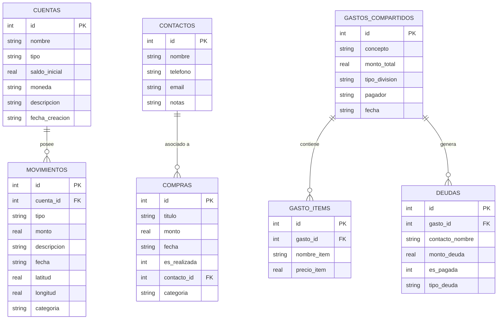

# LocalCash - Sistema de Gestión Financiera Personal y Grupal Offline

**Asignatura:** Desarrollo de Aplicaciones Móviles  
**Docente:** Benjamín Mora Torres  
**Integrantes:** 
* Kevin Moraga
* Martín Lonconado
* Pablo Mendoza
**Institución:** Santo Tomás  
**Plataforma:** Android Nativo (Java)  
**Versión:** 1.0 (Evaluación A2)

---

## 1. Descripción del Proyecto

**LocalCash** (CashoLocal) es una aplicación móvil nativa desarrollada en **Java** para el sistema operativo Android, concebida para brindar una solución integral, privada y 100% offline a la gestión de finanzas personales y grupales.

La aplicación opera sin requerir servidores remotos ni planes de datos móviles para su lógica de negocio: todos los datos se almacenan y procesan de forma local en el dispositivo a través de **SQLite**, garantizando total confidencialidad, rapidez y disponibilidad ininterrumpida. La seguridad de acceso está reforzada mediante **autenticación biométrica nativa (huella dactilar)**. Además, incorpora capacidades de **geolocalización y mapas interactivos** para georreferenciar gastos e ingresos en tiempo real.

---

## 2. Pilares Técnicos Fundamentales

1. **Desarrollo Nativo en Java:** Implementado íntegramente en lenguaje Java utilizando los estándares modernos de AndroidX y Material Design Components.
2. **Persistencia 100% Local y Offline con SQLite:** La totalidad de las entidades (cuentas, movimientos, compras, contactos y gastos compartidos) residen en una base de datos relacional local (`casholocal.db`), asegurando atomicidad, integridad referencial y cero dependencia de backend.
3. **Autenticación Biométrica de Grado de Seguridad:** Integración de la biblioteca `androidx.biometric.BiometricPrompt`, permitiendo el desbloqueo mediante huella dactilar o credenciales seguras del sistema operativo con fallback preventivo en dispositivos no enrolados.
4. **Geolocalización y Mapa Interactivo:** Empleo de **Google Maps SDK** y **Google Play Services Location (FusedLocationProviderClient)** para la captura precisa de coordenadas GPS, visualización de marcadores vectoriales personalizados por tipo de transacción (ingresos en verde, egresos en rojo) y registro interactivo de movimientos directamente al pulsar sobre el mapa.

---

## 3. Módulos y Funcionalidades Principales

### 3.1. Panel de Inicio (Home & Balance)
* **Balance Financiero Consolidado:** Cálculo dinámico y en tiempo real del saldo neto total (`Saldos iniciales + Ingresos - Egresos`).
* **Tarjetas de Cuentas Financieras:** Visualización en carrusel horizontal de cuentas (Bancaria, Efectivo, Tarjeta de Crédito, Ahorro) con saldo actualizado en pesos chilenos (CLP).
* **Acciones Rápidas:** Botones directos para registrar Ingreso Rápido, Gasto Rápido o Dividir Cuenta.
* **Transacciones Recientes:** Listado de los últimos movimientos con filtro de búsqueda en tiempo real por descripción o categoría.
* **Creación de Nuevas Cuentas:** Modal interactivo para agregar cuentas con nombre, tipo y saldo inicial.

### 3.2. Gestión de Compras (Purchases)
* **Pestañas de Estado:**
  * **Realizadas:** Historial de compras efectivamente ejecutadas y descontadas del balance financiero.
  * **Agendadas:** Planificador de compras presupuestadas a futuro (no descuentan saldo hasta ser concretadas).
* **Transición de Estado con Un Toque:** Capacidad de marcar compras agendadas como "Realizadas", momento en el cual se registra el egreso financiero en el balance sin duplicidad.
* **Vinculación con Contactos:** Posibilidad de asociar una compra a una persona específica de la agenda.
* **Detalle Completo & Navegación:** Modal emergente al pulsar una tarjeta para consultar fecha, categoría, contacto vinculado, coordenadas GPS y botón para ver su ubicación en el mapa.

### 3.3. Gastos Compartidos y División de Cuentas (Shared Expenses)
* **División Grupal Automática:** Asignación equitativa del costo de servicios, salidas o compras comunes entre múltiples participantes.
* **Definición del Pagador:** Registro explícito de quién asumió el desembolso inicial (el usuario o un tercero).
* **Matriz de Deudas:**
  * **Por Cobrar ("Me deben"):** Monitoreo del dinero que otros participantes adeudan al usuario.
  * **Por Pagar ("Debo pagar"):** Registro de deudas pendientes asumidas con terceros.
* **Saldar Deudas:** Botón directo para marcar una deuda como saldada, actualizando los contadores y pasando al tab de "Saldadas".

### 3.4. Directorio Local de Contactos (Contacts)
* **Agenda Interna:** Directorio exclusivo de la app con nombre completo, teléfono/WhatsApp, correo y notas de relación (Amigo, Trabajo, Familia).
* **Generación Dinámica de Iniciales:** Avatares automáticos con la letra inicial y colores corporativos.
* **Sincronización en Diálogos:** Los contactos registrados aparecen inmediatamente en los selectores de compras y gastos compartidos.

### 3.5. Mapa de Gastos (Map Activity)
* **Marcadores Personalizados:** Pines vectoriales diseñados a medida que identifican gráficamente gastos (rojo) e ingresos (verde).
* **Filtros por Chips:** Alternar vista de marcadores entre "Todos", "Gastos" e "Ingresos".
* **Creación Directa desde el Mapa:** Al tocar cualquier punto del mapa (clic simple o prolongado), se despliega una confirmación y diálogo para registrar un movimiento en esas coordenadas exactas.
* **Recentrado Inteligente:** Botón de recentrado automático a la posición actual del usuario mediante GPS de alta precisión.

---

## 4. Arquitectura de Software

El proyecto sigue una arquitectura **MVC (Modelo - Vista - Controlador)** adaptada a las buenas prácticas del ecosistema Android:

```
com.example.casholocal/
│
├── Models (POJO / Entidades de Negocio)
│   ├── CuentaModel.java                # Entidad de cuenta financiera
│   ├── MovimientoModel.java            # Entidad de movimiento (ingreso/egreso/GPS)
│   ├── CompraModel.java                # Entidad de compras realizadas y agendadas
│   ├── ContactoModel.java              # Entidad de contactos de la agenda
│   └── DeudaModel.java                 # Entidad de deudas y saldos grupales
│
├── Views / Adapters (Presentación y Enlace de Datos)
│   ├── CuentaAdapter.java              # Adaptador horizontal de cuentas
│   ├── MovimientoAdapter.java          # Adaptador de transacciones recientes
│   ├── CompraAdapter.java              # Adaptador de compras con modal de detalle
│   ├── ContactoAdapter.java            # Adaptador del directorio de contactos
│   └── SharedExpenseAdapter.java       # Adaptador de gastos compartidos y deudas
│
├── Controllers / Activities & Fragments
│   ├── MainActivity.java               # Controlador raíz, Biometría y Bottom Navigation
│   ├── MapActivity.java                # Controlador de Google Maps y marcadores GPS
│   ├── HomeFragment.java               # Fragmento principal del dashboard
│   ├── PurchasesFragment.java          # Fragmento de compras realizadas y agendadas
│   ├── SharedFragment.java             # Fragmento de gastos compartidos
│   └── ContactsFragment.java           # Fragmento de la agenda de contactos
│
├── Dialogs (Ventanas Modales de Entrada)
│   ├── AddTransactionDialogFragment.java   # Diálogo de ingreso/gasto con captura GPS
│   ├── AddPurchaseDialogFragment.java      # Diálogo de nueva compra planificada/realizada
│   ├── AddSharedExpenseDialogFragment.java # Diálogo de división grupal de gastos
│   └── AddContactDialogFragment.java       # Diálogo de nuevo contacto
│
└── Database & Utilities
    ├── DatabaseHelper.java             # SQLiteOpenHelper centralizado con CRUD transaccional
    └── FormatoMoneda.java              # Utilitario para formateo de divisa CLP ($)
```

---

## 5. Diseño y Estructura de la Base de Datos SQLite

La persistencia se gestiona en la base de datos relacional local **`casholocal.db`** (versión 5) con integridad referencial activa (`PRAGMA foreign_keys = ON`).



---

## 6. Tecnologías y Librerías Utilizadas

| Componente | Versión | Propósito |
| :--- | :--- | :--- |
| **Java JDK** | 11 / 21 | Lenguaje base del código de la aplicación. |
| **Android SDK** | Compile: 36 (Android 15) / Min: 26 (Android 8.0) | Compatibilidad moderna garantizada con dispositivos Android. |
| **AndroidX AppCompat** | 1.8.0 | Compatibilidad retroactiva de componentes de interfaz. |
| **Material Components** | 1.14.0 | Implementación de Material Design 3 (CardView, Chips, FAB, TextInputLayout). |
| **AndroidX Biometric** | 1.1.0 | Autenticación biométrica unificada con huella y credenciales de dispositivo. |
| **Play Services Maps** | 19.0.0 | Renderizado del mapa satelital / vectorial y gestión de marcadores. |
| **Play Services Location**| 21.3.0 | Proveedor de ubicación de alta precisión (GPS Fused Location). |
| **SQLite Nativo** | Integrado en Android | Motor relacional local para persistencia 100% offline. |

---

## 7. Guía de Instalación y Ejecución

### 7.1. Requisitos Previos
* **Android Studio** (versión Ladybug, Meerkat o Preview recomendada).
* **JDK 11** o superior configurado como Gradle JDK.
* **Dispositivo Android o Emulador** con Android 8.0 (API 26) o superior.

### 7.2. Pasos para Compilar y Ejecutar
1. **Abrir el Proyecto:**
   * Abrir Android Studio y seleccionar `Open...`.
   * Seleccionar el directorio del proyecto `EvaluacionA2`.
2. **Sincronización de Gradle:**
   * Permitir que Android Studio sincronice las dependencias del archivo `build.gradle`.
3. **Ejecución de la Aplicación:**
   * Seleccionar un emulador o dispositivo físico conectado por depuración USB.
   * Hacer clic en el botón verde **Run ('app')** o presionar `Shift + F10`.

### 7.3. Prueba de Autenticación Biométrica
* **En Dispositivo Físico:** Al abrir la aplicación, posar el dedo sobre el sensor de huellas.
* **En Emulador de Android Studio:**
  1. Abrir la barra lateral del emulador (`...` / Extended controls).
  2. Ir a la pestaña **Fingerprint**.
  3. Presionar **Touch the sensor** para simular la lectura exitosa de huella dactilar.
  *(Si el emulador no posee huella enrolada, la app permite el acceso de manera segura para facilitar la corrección y evaluación).*

---

## 8. Licencia y Derechos de Autor

Desarrollado con fines exclusivamente académicos para la **Evaluación A2** de la asignatura **Desarrollo de Aplicaciones Móviles**, Santo Tomás. Todos los derechos reservados © 2026.
